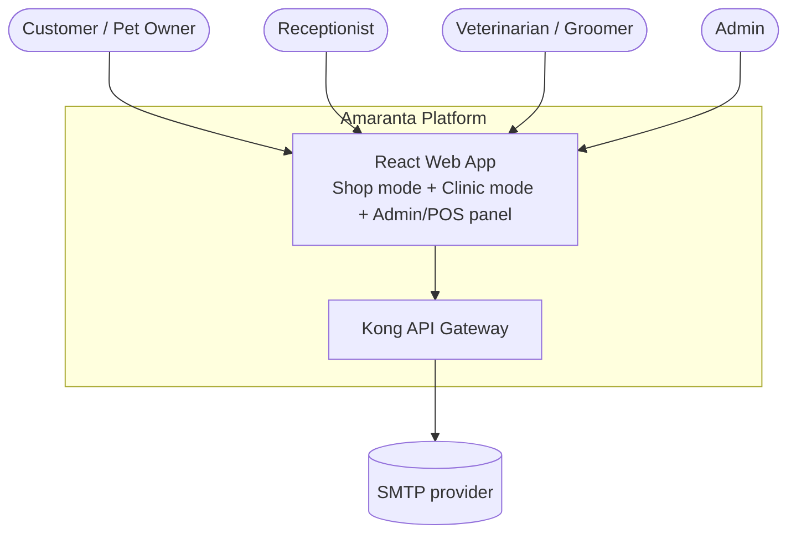
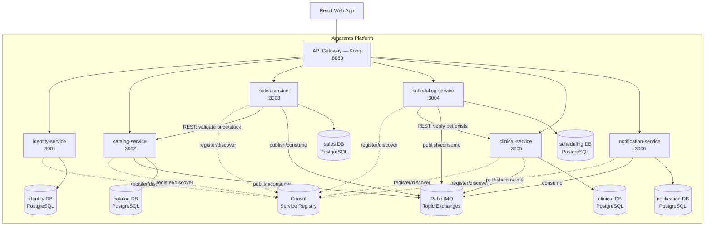

# System Architecture Overview

---

## 1. Adopted architectural style

**Style:** Microservices + Event-Driven (hybrid: synchronous REST for query/validation calls
between services, asynchronous events over RabbitMQ for cross-context side effects)

**Justification:** The domain naturally splits into 6 bounded contexts with different
ownership, different lifecycles, and different scaling needs (`02-domain/domain-map.md`).
Keeping REST calls few and pushing cross-context reactions (stock updates, notifications) onto
events keeps services decoupled and matches the course's explicit requirement for "few REST
APIs, real distribution."

**Reference ADRs:** ADR-001 (documentation language), ADR-002 (database & ORM), ADR-003
(message broker), ADR-004 (service discovery), ADR-005 (API Gateway), ADR-006 (backend
framework) — all in `05-architecture/decisions/records/`.

---

## 2. C4 Diagram — System Level (Context)

---

## 3. C4 Diagram — Container Level

---

## 4. Service catalog

| # | Service | Responsibility | Port | DB | Communication type |
|---|---------|---------------|------|-----|-------------------|
| 1 | api-gateway (Kong) | Routing, JWT validation, rate limiting, CORS | 8080 | — | HTTP proxy, queries Consul |
| 2 | identity-service | Registration, login, JWT issuance, roles | 3001 | PostgreSQL | REST |
| 3 | catalog-service | Products, categories, price, stock | 3002 | PostgreSQL | REST + Events (publishes `StockReserved`/`StockDepleted`, consumes `OrderCreated`/`OrderCancelled`) |
| 4 | sales-service | Cart-to-checkout, orders | 3003 | PostgreSQL | REST (calls catalog) + Events (publishes `OrderCreated`/`OrderPaid`/`OrderCancelled`, consumes `StockReserved`/`StockDepleted`) |
| 5 | scheduling-service | Appointments, business hours, double-booking prevention | 3004 | PostgreSQL | REST (calls clinical) + Events (publishes `AppointmentScheduled`/`AppointmentCancelled`/`AppointmentCompleted`) |
| 6 | clinical-service | Pets, medical records | 3005 | PostgreSQL | REST (exposes pet-exists check) + Events (consumes `AppointmentCompleted`) |
| 7 | notification-service | Email delivery | 3006 | PostgreSQL (delivery log only) | Events only (consumes `OrderCreated`, `OrderPaid`, `OrderCancelled`, `AppointmentScheduled`, `AppointmentCancelled`) |

> Full detail per service (once implementation starts) → `09-microservices/service-catalog.md`

---

## 5. Architectural principles

### P1: API-First
Each service's OpenAPI contract is written before its controllers are implemented
(`07-api/contracts/openapi/[service].yaml`).

### P2: Database per Service
Each of the 6 services owns its own PostgreSQL schema/instance. No service queries another
service's tables directly — only REST or events.

### P3: Few, Coarse REST Calls — Events for Everything Else
Synchronous REST is reserved for calls where the caller needs an immediate answer to proceed
(validate stock before confirming a cart, verify a pet exists before booking). Everything that
is a *reaction* to something that already happened (send an email, decrement stock, open a
medical-record draft) is a domain event over RabbitMQ. This keeps the service-to-service REST
surface deliberately small.

### P4: Fail Fast, Recover Gracefully
Input is validated at the edge (Zod schemas in each controller). Cross-service REST calls
(Sales → Catalog, Scheduling → Clinical) use a Circuit Breaker (`opossum`) with a fallback that
rejects the operation safely rather than leaving it in an inconsistent state.

### P5: Observability by Design
Structured JSON logs (Pino) with a `correlationId` propagated from the Gateway through every
REST call and event, Prometheus metrics, and OpenTelemetry traces from day 1 — not deferred to
"later" (`04-requirements/non-functional.md`, NFR-005).

---

## 6. Adopted architectural patterns

| Pattern | Adopted | Reference |
|---------|---------|-----------|
| API Gateway | Yes — Kong | ADR-005 |
| Service Discovery | Yes — Consul | ADR-004 |
| Database per Service | Yes | This document, §5 P2 |
| Circuit Breaker | Yes — `opossum`, around the two cross-service REST calls (Sales→Catalog, Scheduling→Clinical) | `05-architecture/pattern-guide.md` |
| CQRS | No — read/write models are simple enough not to justify the complexity | `05-architecture/pattern-guide.md` |
| Event Sourcing | No — full event history is not a business requirement here | `05-architecture/pattern-guide.md` |
| Saga (choreographed) | Yes — the checkout flow (`OrderCreated` → `StockReserved`/`StockDepleted` → auto-cancel on failure) is a 2-step choreographed saga | `02-domain/domain-events.md` |
| Outbox Pattern | Yes — every service writes the domain event to an `outbox` table in the same transaction as the aggregate, and a relay process publishes it to RabbitMQ | `05-architecture/pattern-guide.md` |

---

## 7. Cross-cutting concerns

| Concern | Adopted solution | Where it is configured |
|---------|----------------|------------------------|
| Authentication / Authorization | JWT validated at the Kong Gateway (signature/expiry) + RBAC re-checked per service | `00-governance/security-policy.md` |
| Logging | Structured JSON (Pino) + Correlation ID | Shared logger module per service |
| Tracing | OpenTelemetry → Jaeger | Middleware in each NestJS service |
| Health Checks | `GET /health` (liveness) + `GET /health/ready` (readiness, checks DB + RabbitMQ + Consul registration) | Service bootstrap (`main.ts`) |
| Error format | Standard `ErrorResponse` (`{ error, message, traceId }`) | Shared exception filter |
| Rate Limiting | At the Kong Gateway | Kong plugin configuration |
| CORS | Configured in Kong | Kong plugin configuration |
| Circuit Breaker | `opossum` per outbound REST call | Pattern in `pattern-guide.md` |
| Service Discovery | Consul — each service registers itself on boot with a health check | ADR-004 |

---

## 8. Registered architectural technical debt

| ID | Description | Impact | Priority | Target sprint |
|----|-------------|--------|---------|--------------|
| AT-001 | No API Gateway–level authentication cache — every request re-validates the JWT signature | Low (JWT verification is cheap) | P3 | Post-MVP |
| AT-002 | No formal SLO/error-budget tracking (deferred per NFR-002) | None for the academic delivery | P3 | Only if deployed beyond local |

---

## 9. Planned evolution

| Version | Architectural change | Motivation | Estimated date |
|---------|---------------------|------------|----------------|
| v2.0 | Add a payment-service and delivery-service bounded context | Online payment + delivery become in scope | Post-course, if the business grows |
| v2.0 | Move Identity to a dedicated IdP (Keycloak/Auth0) | Auth is a generic subdomain — buy instead of build once budget exists | Post-course |

---

## Key correlations

- Domain bounded contexts → `02-domain/domain-map.md`
- Specific decision ADRs → `05-architecture/decisions/records/`
- Hexagonal architecture per service → `05-architecture/hexagonal-architecture.md`
- Applied patterns → `05-architecture/pattern-guide.md`
- Per-service detail → `09-microservices/service-catalog.md`
