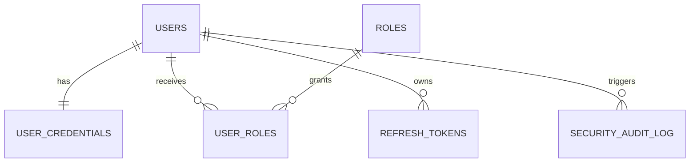
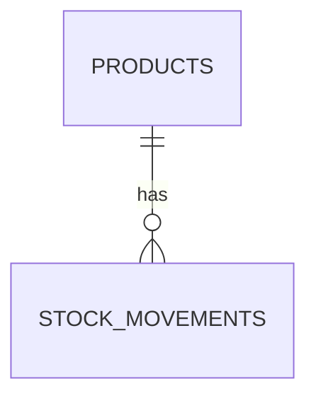
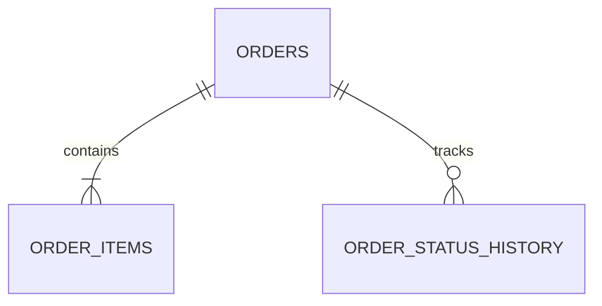
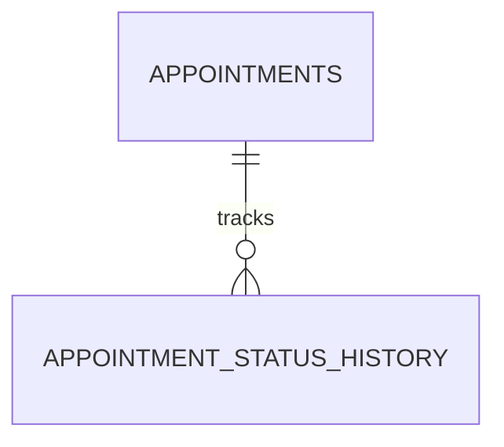
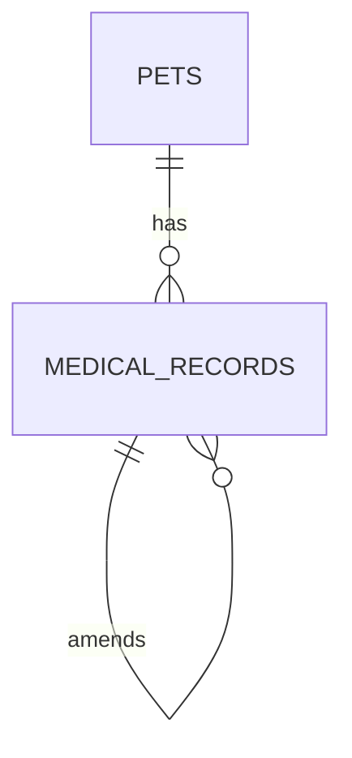
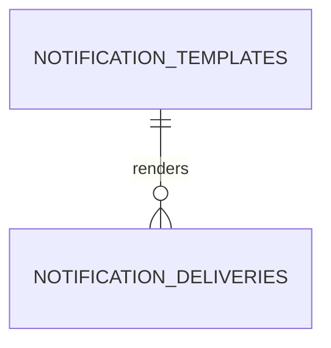

# Data Models per Service - Amaranta Shop

This document defines the MVP SQL data model. The current decision is to use
**PostgreSQL 16 + Prisma**, while keeping services decoupled at the database level:
each microservice has its own database, its own migrations, and its own access rules.

---

## Modeling principles

### 1. Database per Service

Each microservice is the only owner of its tables.

```text
Correct:
  sales-service      -> sales_db.orders
  catalog-service    -> catalog_db.products
  sales-service      -> catalog-service API or events

Incorrect:
  sales-service      -> SELECT * FROM catalog_db.products
```

### 2. SQL only for MVP persistence

Persistent system data is modeled with relational SQL. The API Gateway does not store
business data; any ephemeral gateway state, such as rate-limit counters or token cache,
is outside the persistent data model.

### 3. Standard fields

All business tables use:

```sql
id          UUID PRIMARY KEY DEFAULT gen_random_uuid(),
created_at  TIMESTAMPTZ NOT NULL DEFAULT NOW(),
updated_at  TIMESTAMPTZ NOT NULL DEFAULT NOW(),
deleted_at  TIMESTAMPTZ
```

Rule: `deleted_at IS NULL` means the record is active.

### 4. Naming conventions

```sql
-- Tables:       plural snake_case               -> orders, order_items, users
-- Columns:      descriptive snake_case          -> unit_price_cop, scheduled_at
-- Internal FKs: [singular_table]_id             -> order_id, pet_id
-- External refs: UUID without physical FK       -> customer_id, product_id
-- Indexes:      idx_[table]_[columns]           -> idx_orders_customer_id
-- Unique keys:  uq_[table]_[columns]            -> uq_users_email
-- Checks:       chk_[table]_[rule]              -> chk_products_price_positive
```

### 5. Money

Monetary values are stored as integer Colombian pesos.

```sql
price_cop INTEGER NOT NULL CHECK (price_cop > 0)
```

The MVP does not use decimal subunits for COP.

### 6. Relationships between services

Foreign keys exist only inside the same service database. When a service references data
owned by another service, it stores the external UUID and validates it through an API or
an event.

Examples:

- `orders.customer_id` references a user owned by Identity & Access, but has no FK.
- `order_items.product_id` references a product owned by `catalog-service`, but stores
  `product_name` and `unit_price_cop` as an audit snapshot.
- `appointments.pet_id` references a pet owned by `clinical-service`, validated by API.

---

## Common baseline SQL security

Each database must start with minimum extensions, roles, and privileges. Replace the
service name with `identity`, `catalog`, `sales`, `scheduling`, `clinical`, or
`notification`.

```sql
CREATE EXTENSION IF NOT EXISTS pgcrypto;

REVOKE ALL ON SCHEMA public FROM PUBLIC;

CREATE ROLE service_migrator LOGIN PASSWORD '<from-env>' NOINHERIT;
CREATE ROLE service_app LOGIN PASSWORD '<from-env>' NOINHERIT;

GRANT USAGE ON SCHEMA public TO service_app;
GRANT USAGE, CREATE ON SCHEMA public TO service_migrator;

-- After creating tables:
-- GRANT SELECT, INSERT, UPDATE ON <business_tables> TO service_app;
-- GRANT INSERT ON <audit_tables> TO service_app;
-- Do not grant SUPERUSER, CREATEDB, or permissions on databases owned by other services.
```

Required rules:

- The application uses prepared statements or a parameterized ORM.
- Migrations run with `service_migrator`.
- Runtime access uses `service_app`.
- Runtime access does not receive `DELETE`; business deletes are `UPDATE deleted_at`.
- Secrets live in environment variables, not in tables or Git.
- Passwords and tokens are always stored as hashes.

---

## Common event tables

Services that publish events use `outbox_messages`. Services that consume events use
`processed_events` for idempotency.

```sql
CREATE TABLE outbox_messages (
  id              UUID PRIMARY KEY DEFAULT gen_random_uuid(),
  event_type      VARCHAR(100) NOT NULL,
  aggregate_type  VARCHAR(100) NOT NULL,
  aggregate_id    UUID NOT NULL,
  topic           VARCHAR(150) NOT NULL,
  payload_json    JSONB NOT NULL,
  metadata_json   JSONB NOT NULL DEFAULT '{}'::jsonb,
  status          VARCHAR(20) NOT NULL DEFAULT 'PENDING'
                  CHECK (status IN ('PENDING', 'PUBLISHED', 'FAILED')),
  attempts        INTEGER NOT NULL DEFAULT 0 CHECK (attempts >= 0),
  last_error      TEXT,
  created_at      TIMESTAMPTZ NOT NULL DEFAULT NOW(),
  published_at    TIMESTAMPTZ
);

CREATE INDEX idx_outbox_pending
  ON outbox_messages (created_at)
  WHERE status IN ('PENDING', 'FAILED');

CREATE TABLE processed_events (
  event_id       UUID PRIMARY KEY,
  event_type     VARCHAR(100) NOT NULL,
  source_service VARCHAR(100) NOT NULL,
  processed_at   TIMESTAMPTZ NOT NULL DEFAULT NOW()
);
```

---

## Service: api-gateway

**SQL engine:** Not applicable for persistent data.

**Data owner:** Owns no business data.

**Justification:** The gateway routes requests, validates JWTs, applies CORS, and enforces
rate limits. Identity truth belongs to Identity & Access; the gateway must not duplicate it.

---

## Service: identity-service / auth-service

**SQL engine:** PostgreSQL 16.

**Owned data:** users, credentials, roles, refresh tokens, and security audit records.

**Naming note:** The bounded context is Identity & Access. Architecture documents call it
`identity-service`; the current repository folder is `09-microservices/services/02-auth-service/`.

**Justification:** authentication and role assignment require uniqueness, ACID transactions,
integrity constraints, and auditability.

### SQL schema

```sql
CREATE TABLE users (
  id          UUID PRIMARY KEY DEFAULT gen_random_uuid(),
  full_name   VARCHAR(100) NOT NULL,
  email       VARCHAR(255) NOT NULL,
  phone       VARCHAR(20),
  status      VARCHAR(20) NOT NULL DEFAULT 'ACTIVE'
              CHECK (status IN ('ACTIVE', 'DEACTIVATED')),
  created_at  TIMESTAMPTZ NOT NULL DEFAULT NOW(),
  updated_at  TIMESTAMPTZ NOT NULL DEFAULT NOW(),
  deleted_at  TIMESTAMPTZ,

  CONSTRAINT chk_users_full_name_length
    CHECK (char_length(trim(full_name)) BETWEEN 2 AND 100),
  CONSTRAINT chk_users_phone_format
    CHECK (phone IS NULL OR phone ~ '^[0-9]{10}$')
);

CREATE UNIQUE INDEX uq_users_email_active
  ON users (lower(email))
  WHERE deleted_at IS NULL;

CREATE TABLE user_credentials (
  user_id              UUID PRIMARY KEY REFERENCES users(id) ON DELETE CASCADE,
  password_hash        VARCHAR(255) NOT NULL,
  password_changed_at  TIMESTAMPTZ NOT NULL DEFAULT NOW(),
  failed_attempts      INTEGER NOT NULL DEFAULT 0 CHECK (failed_attempts >= 0),
  locked_until         TIMESTAMPTZ,
  updated_at           TIMESTAMPTZ NOT NULL DEFAULT NOW(),

  CONSTRAINT chk_credentials_password_hash_length
    CHECK (char_length(password_hash) >= 60)
);

CREATE TABLE roles (
  id          UUID PRIMARY KEY DEFAULT gen_random_uuid(),
  name        VARCHAR(50) NOT NULL UNIQUE
              CHECK (name IN ('CUSTOMER', 'RECEPTIONIST', 'VETERINARIAN', 'GROOMER', 'ADMIN')),
  description TEXT,
  created_at  TIMESTAMPTZ NOT NULL DEFAULT NOW()
);

CREATE TABLE user_roles (
  id          UUID PRIMARY KEY DEFAULT gen_random_uuid(),
  user_id     UUID NOT NULL REFERENCES users(id) ON DELETE CASCADE,
  role_id     UUID NOT NULL REFERENCES roles(id) ON DELETE RESTRICT,
  assigned_at TIMESTAMPTZ NOT NULL DEFAULT NOW(),
  assigned_by UUID REFERENCES users(id) ON DELETE SET NULL,
  revoked_at  TIMESTAMPTZ
);

CREATE UNIQUE INDEX uq_user_roles_active
  ON user_roles (user_id, role_id)
  WHERE revoked_at IS NULL;

CREATE TABLE refresh_tokens (
  id                    UUID PRIMARY KEY DEFAULT gen_random_uuid(),
  user_id               UUID NOT NULL REFERENCES users(id) ON DELETE CASCADE,
  token_hash            CHAR(64) NOT NULL UNIQUE,
  expires_at            TIMESTAMPTZ NOT NULL,
  revoked_at            TIMESTAMPTZ,
  replaced_by_token_id  UUID REFERENCES refresh_tokens(id) ON DELETE SET NULL,
  user_agent            TEXT,
  ip_address            INET,
  created_at            TIMESTAMPTZ NOT NULL DEFAULT NOW()
);

CREATE INDEX idx_refresh_tokens_user_active
  ON refresh_tokens (user_id, expires_at)
  WHERE revoked_at IS NULL;

CREATE TABLE security_audit_log (
  id          UUID PRIMARY KEY DEFAULT gen_random_uuid(),
  actor_id    UUID REFERENCES users(id) ON DELETE SET NULL,
  action      VARCHAR(100) NOT NULL,
  resource    VARCHAR(100) NOT NULL,
  result      VARCHAR(20) NOT NULL CHECK (result IN ('SUCCESS', 'FAILURE')),
  source_ip   INET,
  metadata    JSONB NOT NULL DEFAULT '{}'::jsonb,
  created_at  TIMESTAMPTZ NOT NULL DEFAULT NOW()
);

CREATE INDEX idx_security_audit_log_actor_date
  ON security_audit_log (actor_id, created_at DESC);
```

### Initial seed

```sql
INSERT INTO roles (name, description) VALUES
  ('CUSTOMER', 'Registered customer and pet owner'),
  ('RECEPTIONIST', 'Front-desk staff member'),
  ('VETERINARIAN', 'Veterinary professional'),
  ('GROOMER', 'Grooming professional'),
  ('ADMIN', 'Business administrator')
ON CONFLICT (name) DO NOTHING;
```

### Relationships



---

## Service: catalog-service

**SQL engine:** PostgreSQL 16.

**Owned data:** products, logical categories, prices, and stock.

**Justification:** stock and price require transactional consistency. The catalog also
needs efficient lookup by SKU, category, and active status.

### SQL schema

```sql
CREATE TABLE products (
  id             UUID PRIMARY KEY DEFAULT gen_random_uuid(),
  sku            VARCHAR(60) NOT NULL UNIQUE,
  name           VARCHAR(120) NOT NULL,
  description    VARCHAR(500) NOT NULL,
  category       VARCHAR(30) NOT NULL
                 CHECK (category IN ('FOOD', 'ACCESSORIES', 'HYGIENE', 'MEDICATION', 'TOYS')),
  price_cop      INTEGER NOT NULL CHECK (price_cop > 0),
  stock_quantity INTEGER NOT NULL DEFAULT 0 CHECK (stock_quantity >= 0),
  image_url      TEXT NOT NULL,
  is_active      BOOLEAN NOT NULL DEFAULT TRUE,
  created_by     UUID,
  updated_by     UUID,
  created_at     TIMESTAMPTZ NOT NULL DEFAULT NOW(),
  updated_at     TIMESTAMPTZ NOT NULL DEFAULT NOW(),
  deleted_at     TIMESTAMPTZ,

  CONSTRAINT chk_products_name_length
    CHECK (char_length(trim(name)) BETWEEN 2 AND 120)
);

CREATE INDEX idx_products_category_active
  ON products (category, is_active)
  WHERE deleted_at IS NULL;

CREATE INDEX idx_products_name
  ON products (name);

CREATE TABLE stock_movements (
  id              UUID PRIMARY KEY DEFAULT gen_random_uuid(),
  product_id      UUID NOT NULL REFERENCES products(id) ON DELETE RESTRICT,
  movement_type   VARCHAR(30) NOT NULL
                  CHECK (movement_type IN ('INITIAL', 'ADJUSTMENT', 'RESERVATION', 'RELEASE', 'SALE')),
  quantity_delta  INTEGER NOT NULL CHECK (quantity_delta <> 0),
  source_event_id UUID,
  source_order_id UUID,
  reason          TEXT,
  created_by      UUID,
  created_at      TIMESTAMPTZ NOT NULL DEFAULT NOW()
);

CREATE INDEX idx_stock_movements_product_date
  ON stock_movements (product_id, created_at DESC);

CREATE UNIQUE INDEX uq_stock_movements_event_product
  ON stock_movements (source_event_id, product_id)
  WHERE source_event_id IS NOT NULL;
```

### Relationships



---

## Service: sales-service

**SQL engine:** PostgreSQL 16.

**Owned data:** orders, order items, commercial status, and checkout traceability.

**Justification:** an order and its items must be stored in a single transaction. The total
must remain consistent with item subtotals, and stock events must be processed idempotently.

### SQL schema

```sql
CREATE TABLE orders (
  id                  UUID PRIMARY KEY DEFAULT gen_random_uuid(),
  customer_id         UUID NOT NULL,
  channel             VARCHAR(20) NOT NULL CHECK (channel IN ('ONLINE', 'IN_STORE')),
  created_by          UUID NOT NULL,
  status              VARCHAR(20) NOT NULL DEFAULT 'PENDING'
                      CHECK (status IN ('PENDING', 'PAID', 'CANCELLED', 'FULFILLED')),
  stock_status        VARCHAR(30) NOT NULL DEFAULT 'PENDING_RESERVATION'
                      CHECK (stock_status IN ('PENDING_RESERVATION', 'RESERVED', 'FAILED', 'RELEASED')),
  total_cop           INTEGER NOT NULL DEFAULT 0 CHECK (total_cop >= 0),
  cancellation_reason TEXT,
  paid_at             TIMESTAMPTZ,
  fulfilled_at        TIMESTAMPTZ,
  created_at          TIMESTAMPTZ NOT NULL DEFAULT NOW(),
  updated_at          TIMESTAMPTZ NOT NULL DEFAULT NOW(),
  deleted_at          TIMESTAMPTZ
);

CREATE INDEX idx_orders_customer_date
  ON orders (customer_id, created_at DESC)
  WHERE deleted_at IS NULL;

CREATE INDEX idx_orders_status
  ON orders (status)
  WHERE deleted_at IS NULL;

CREATE TABLE order_items (
  id             UUID PRIMARY KEY DEFAULT gen_random_uuid(),
  order_id       UUID NOT NULL REFERENCES orders(id) ON DELETE CASCADE,
  product_id     UUID NOT NULL,
  product_sku    VARCHAR(60) NOT NULL,
  product_name   VARCHAR(120) NOT NULL,
  unit_price_cop INTEGER NOT NULL CHECK (unit_price_cop > 0),
  quantity       INTEGER NOT NULL CHECK (quantity BETWEEN 1 AND 50),
  subtotal_cop   INTEGER NOT NULL CHECK (subtotal_cop > 0),
  created_at     TIMESTAMPTZ NOT NULL DEFAULT NOW(),
  updated_at     TIMESTAMPTZ NOT NULL DEFAULT NOW(),
  deleted_at     TIMESTAMPTZ,

  CONSTRAINT uq_order_items_order_product UNIQUE (order_id, product_id),
  CONSTRAINT chk_order_items_subtotal
    CHECK (subtotal_cop = unit_price_cop * quantity)
);

CREATE INDEX idx_order_items_order
  ON order_items (order_id);

CREATE TABLE order_status_history (
  id          UUID PRIMARY KEY DEFAULT gen_random_uuid(),
  order_id    UUID NOT NULL REFERENCES orders(id) ON DELETE CASCADE,
  from_status VARCHAR(20),
  to_status   VARCHAR(20) NOT NULL,
  changed_by  UUID NOT NULL,
  reason      TEXT,
  created_at  TIMESTAMPTZ NOT NULL DEFAULT NOW()
);

CREATE INDEX idx_order_status_history_order
  ON order_status_history (order_id, created_at DESC);
```

### Total rule

`orders.total_cop` is recalculated inside the transaction that creates or modifies items.
The database guarantees each item subtotal; the `Order` aggregate guarantees that the order
total equals the sum of its items.

### Relationships



---

## Service: scheduling-service

**SQL engine:** PostgreSQL 16.

**Owned data:** appointments, agenda, and status changes.

**Justification:** the agenda must validate business hours and prevent overlapping
appointments. This is a critical domain rule, so it is validated in the use case and
reinforced with SQL.

### SQL schema

```sql
CREATE EXTENSION IF NOT EXISTS btree_gist;

CREATE TABLE appointments (
  id                  UUID PRIMARY KEY DEFAULT gen_random_uuid(),
  pet_id              UUID NOT NULL,
  owner_id            UUID NOT NULL,
  professional_id     UUID NOT NULL,
  service_type        VARCHAR(30) NOT NULL
                      CHECK (service_type IN ('MEDICAL_CONSULT', 'VACCINATION', 'GROOMING', 'SURGERY', 'EMERGENCY')),
  scheduled_at        TIMESTAMPTZ NOT NULL,
  duration_minutes    INTEGER NOT NULL CHECK (duration_minutes BETWEEN 15 AND 120),
  status              VARCHAR(20) NOT NULL DEFAULT 'PENDING'
                      CHECK (status IN ('PENDING', 'CONFIRMED', 'IN_PROGRESS', 'COMPLETED', 'CANCELLED', 'NO_SHOW')),
  created_by          UUID NOT NULL,
  notes               VARCHAR(300),
  cancellation_reason TEXT,
  completed_at        TIMESTAMPTZ,
  created_at          TIMESTAMPTZ NOT NULL DEFAULT NOW(),
  updated_at          TIMESTAMPTZ NOT NULL DEFAULT NOW(),
  deleted_at          TIMESTAMPTZ,

  CONSTRAINT chk_appointments_future_window
    CHECK (scheduled_at > created_at),
  CONSTRAINT chk_appointments_business_hours
    CHECK (
      EXTRACT(ISODOW FROM scheduled_at AT TIME ZONE 'America/Bogota') BETWEEN 1 AND 6
      AND (
        (
          (scheduled_at AT TIME ZONE 'America/Bogota')::time >= TIME '07:00'
          AND ((scheduled_at AT TIME ZONE 'America/Bogota') + duration_minutes * INTERVAL '1 minute')::time <= TIME '12:00'
        )
        OR
        (
          (scheduled_at AT TIME ZONE 'America/Bogota')::time >= TIME '14:00'
          AND ((scheduled_at AT TIME ZONE 'America/Bogota') + duration_minutes * INTERVAL '1 minute')::time <= TIME '18:00'
        )
      )
    )
);

ALTER TABLE appointments
  ADD CONSTRAINT ex_appointments_no_professional_overlap
  EXCLUDE USING gist (
    professional_id WITH =,
    tstzrange(scheduled_at, scheduled_at + duration_minutes * INTERVAL '1 minute', '[)') WITH &&
  )
  WHERE (status NOT IN ('CANCELLED', 'NO_SHOW') AND deleted_at IS NULL);

CREATE INDEX idx_appointments_owner_date
  ON appointments (owner_id, scheduled_at DESC)
  WHERE deleted_at IS NULL;

CREATE INDEX idx_appointments_professional_date
  ON appointments (professional_id, scheduled_at)
  WHERE deleted_at IS NULL;

CREATE TABLE appointment_status_history (
  id             UUID PRIMARY KEY DEFAULT gen_random_uuid(),
  appointment_id UUID NOT NULL REFERENCES appointments(id) ON DELETE CASCADE,
  from_status    VARCHAR(20),
  to_status      VARCHAR(20) NOT NULL,
  changed_by     UUID NOT NULL,
  reason         TEXT,
  created_at     TIMESTAMPTZ NOT NULL DEFAULT NOW()
);

CREATE INDEX idx_appointment_status_history_appointment
  ON appointment_status_history (appointment_id, created_at DESC);
```

### Portability note

The `EXCLUDE USING gist` constraint is PostgreSQL-specific and is justified by the critical
no-double-booking rule. If this service moves to MySQL or SQL Server, this validation must
be preserved with an equivalent transactional query and optimistic or pessimistic locking.

### Relationships



---

## Service: clinical-service

**SQL engine:** PostgreSQL 16.

**Owned data:** pets and medical records.

**Justification:** the medical history is a critical data asset. It is stored as an audited,
mostly append-only record: a correction is added as a new record referencing the previous one.

### SQL schema

```sql
CREATE TABLE pets (
  id          UUID PRIMARY KEY DEFAULT gen_random_uuid(),
  owner_id    UUID NOT NULL,
  name        VARCHAR(50) NOT NULL,
  species     VARCHAR(20) NOT NULL CHECK (species IN ('DOG', 'CAT', 'OTHER')),
  breed       VARCHAR(80),
  birth_date  DATE,
  weight_kg   NUMERIC(5,2) CHECK (weight_kg IS NULL OR weight_kg > 0),
  photo_url   TEXT,
  status      VARCHAR(20) NOT NULL DEFAULT 'ACTIVE'
              CHECK (status IN ('ACTIVE', 'DECEASED', 'INACTIVE')),
  created_by  UUID NOT NULL,
  created_at  TIMESTAMPTZ NOT NULL DEFAULT NOW(),
  updated_at  TIMESTAMPTZ NOT NULL DEFAULT NOW(),
  deleted_at  TIMESTAMPTZ,

  CONSTRAINT chk_pets_name_length
    CHECK (char_length(trim(name)) BETWEEN 1 AND 50)
);

CREATE INDEX idx_pets_owner
  ON pets (owner_id)
  WHERE deleted_at IS NULL;

CREATE TABLE medical_records (
  id                 UUID PRIMARY KEY DEFAULT gen_random_uuid(),
  pet_id             UUID NOT NULL REFERENCES pets(id) ON DELETE RESTRICT,
  appointment_id     UUID NOT NULL UNIQUE,
  veterinarian_id    UUID NOT NULL,
  diagnosis          VARCHAR(1000) NOT NULL,
  treatment          VARCHAR(1000),
  notes              TEXT,
  amended_record_id  UUID REFERENCES medical_records(id) ON DELETE RESTRICT,
  created_at         TIMESTAMPTZ NOT NULL DEFAULT NOW(),
  updated_at         TIMESTAMPTZ NOT NULL DEFAULT NOW(),
  deleted_at         TIMESTAMPTZ,

  CONSTRAINT chk_medical_records_diagnosis_length
    CHECK (char_length(trim(diagnosis)) BETWEEN 1 AND 1000),
  CONSTRAINT chk_medical_records_treatment_length
    CHECK (treatment IS NULL OR char_length(treatment) <= 1000)
);

CREATE INDEX idx_medical_records_pet_date
  ON medical_records (pet_id, created_at DESC)
  WHERE deleted_at IS NULL;

CREATE INDEX idx_medical_records_veterinarian_date
  ON medical_records (veterinarian_id, created_at DESC)
  WHERE deleted_at IS NULL;
```

### Immutability rule

The SQL runtime role should have `INSERT` and `SELECT` on `medical_records`, but not
`UPDATE` or `DELETE` on diagnosis, treatment, or notes. To correct a record, insert a new
one with `amended_record_id`.

### Relationships



---

## Service: notification-service

**SQL engine:** PostgreSQL 16.

**Owned data:** notification templates and delivery log.

**Justification:** the service needs idempotency, auditability, and simple retries. It is not
the source of truth for orders, appointments, or users.

### SQL schema

```sql
CREATE TABLE notification_templates (
  id               UUID PRIMARY KEY DEFAULT gen_random_uuid(),
  code             VARCHAR(80) NOT NULL UNIQUE,
  channel          VARCHAR(20) NOT NULL DEFAULT 'EMAIL'
                   CHECK (channel IN ('EMAIL')),
  subject_template VARCHAR(200) NOT NULL,
  body_template    TEXT NOT NULL,
  is_active        BOOLEAN NOT NULL DEFAULT TRUE,
  created_at       TIMESTAMPTZ NOT NULL DEFAULT NOW(),
  updated_at       TIMESTAMPTZ NOT NULL DEFAULT NOW(),
  deleted_at       TIMESTAMPTZ
);

CREATE TABLE notification_deliveries (
  id              UUID PRIMARY KEY DEFAULT gen_random_uuid(),
  source_event_id UUID NOT NULL,
  event_type      VARCHAR(100) NOT NULL,
  aggregate_id    UUID NOT NULL,
  template_code   VARCHAR(80) NOT NULL,
  recipient_email VARCHAR(255) NOT NULL,
  channel         VARCHAR(20) NOT NULL DEFAULT 'EMAIL'
                  CHECK (channel IN ('EMAIL')),
  status          VARCHAR(20) NOT NULL DEFAULT 'PENDING'
                  CHECK (status IN ('PENDING', 'SENT', 'FAILED', 'SKIPPED')),
  attempts        INTEGER NOT NULL DEFAULT 0 CHECK (attempts >= 0),
  last_error      TEXT,
  sent_at         TIMESTAMPTZ,
  created_at      TIMESTAMPTZ NOT NULL DEFAULT NOW(),
  updated_at      TIMESTAMPTZ NOT NULL DEFAULT NOW(),

  CONSTRAINT uq_notification_delivery_event_template_recipient
    UNIQUE (source_event_id, template_code, recipient_email)
);

CREATE INDEX idx_notification_deliveries_status
  ON notification_deliveries (status, created_at);

CREATE INDEX idx_notification_deliveries_recipient
  ON notification_deliveries (recipient_email, created_at DESC);
```

### Relationships



---

## Data ownership matrix

| Data | Owner | Used by other services as... | Allowed access |
|------|-------|------------------------------|----------------|
| User, role, credential | `identity-service` / `auth-service` | `customer_id`, `created_by`, `professional_id`, `veterinarian_id` | JWT, internal API, or security claim |
| Product, current price, stock | `catalog-service` | `product_id` and snapshot in `order_items` | Catalog API and stock events |
| Order and order items | `sales-service` | `source_order_id`, `OrderCreated`, `OrderPaid`, `OrderCancelled` events | Sales API and events |
| Appointment | `scheduling-service` | `appointment_id` in medical records | Scheduling API and events |
| Pet and medical history | `clinical-service` | `pet_id` in appointments | Clinical API |
| Notification delivery | `notification-service` | Not shared as business data | Service audit only |

---

## Schema migration

**Recommended tool:** Prisma Migrate with reviewable SQL migrations.

**File naming convention:**

```text
V001__create_extensions.sql
V002__create_identity_tables.sql
V003__seed_identity_roles.sql
V004__create_indexes.sql
V005__grant_runtime_permissions.sql
```

### Rules

- Migrations are forward-only.
- One migration represents one logical change.
- Never edit a migration that already ran in another environment.
- Destructive changes are handled in two phases:
  1. add the new column/table and update the code;
  2. remove the old column/table once it is no longer used.
- System catalog seeds, such as roles, go in separate migrations.

### Compatible changes

```sql
ALTER TABLE products ADD COLUMN brand VARCHAR(80);
ALTER TABLE orders ADD COLUMN notes TEXT;
CREATE INDEX idx_products_sku ON products (sku);
```

### Incompatible changes

```sql
-- Avoid this in a single release if production code still reads the old column.
ALTER TABLE orders DROP COLUMN customer_id;
ALTER TABLE products ALTER COLUMN price_cop TYPE NUMERIC(12,2);
```

---

## Correlations

| This section is fed by... | And feeds into... |
|---------------------------|-------------------|
| `02-domain/entities-and-rules.md` -> domain entities | Database tables |
| `02-domain/domain-events.md` -> system events | `outbox_messages` and `processed_events` |
| `05-architecture/` -> engine and pattern decisions | Engine choice in `models.md` |
| `models.md` | `07-api/contracts/` -> data exposed by each service |
| `models.md` | `08-uml/` -> ER diagrams |
| `models.md` | `09-microservices/[service]/data-model.md` |
