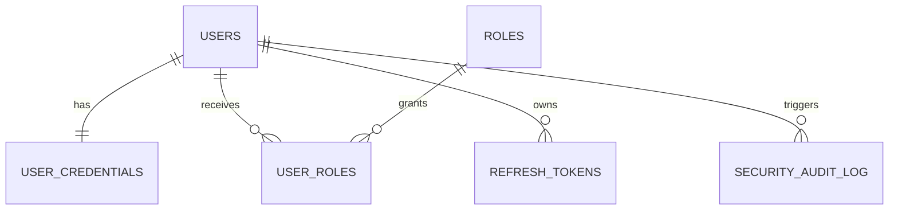
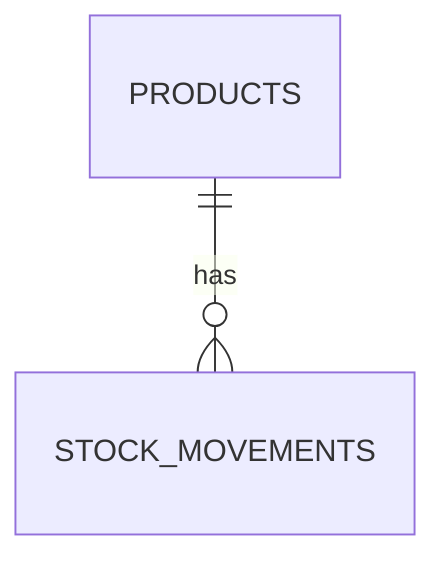
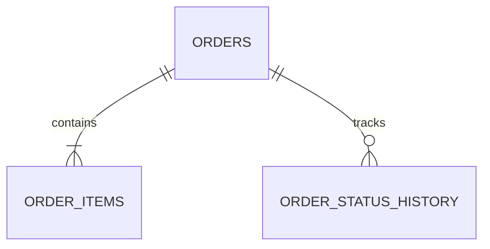
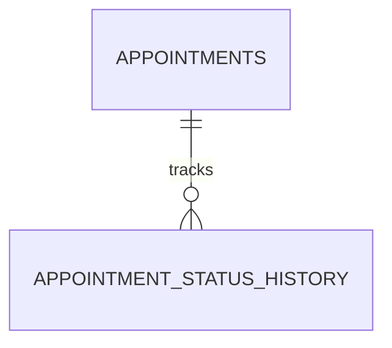
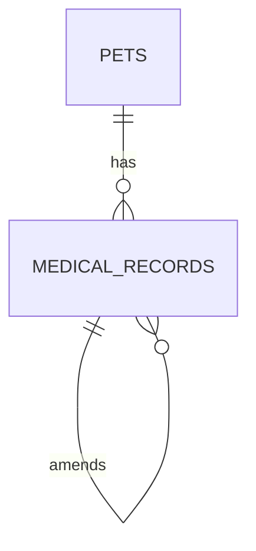
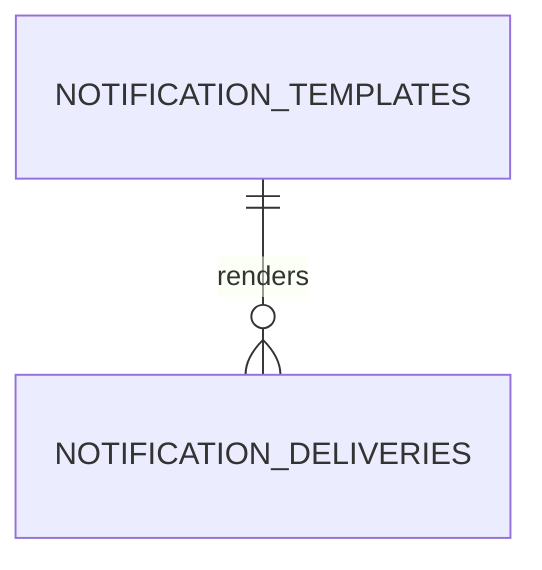

# Modelos de datos por servicio - Amaranta Shop

Este documento define el modelo de datos SQL del MVP. La decision vigente es usar
**PostgreSQL 16 + Prisma**, pero el diseno evita acoplar servicios por base de datos:
cada microservicio tiene su propia base, sus propias migraciones y sus propias reglas
de acceso.

---

## Principios de modelado

### 1. Database per Service

Cada microservicio es el unico owner de sus tablas.

```text
Correcto:
  sales-service      -> sales_db.orders
  catalog-service    -> catalog_db.products
  sales-service      -> catalog-service API o eventos

Incorrecto:
  sales-service      -> SELECT * FROM catalog_db.products
```

### 2. Solo SQL para persistencia del MVP

Los datos persistentes del sistema se modelan en SQL relacional. El API Gateway no
guarda datos de negocio; cualquier estado efimero de gateway, como rate limit o cache
de tokens, queda fuera del modelo persistente.

### 3. Campos estandar

Todas las tablas de negocio usan:

```sql
id          UUID PRIMARY KEY DEFAULT gen_random_uuid(),
created_at  TIMESTAMPTZ NOT NULL DEFAULT NOW(),
updated_at  TIMESTAMPTZ NOT NULL DEFAULT NOW(),
deleted_at  TIMESTAMPTZ
```

Regla: `deleted_at IS NULL` significa registro activo.

### 4. Convenciones

```sql
-- Tablas:      snake_case plural              -> orders, order_items, users
-- Columnas:    snake_case descriptivo         -> unit_price_cop, scheduled_at
-- FKs internas:[tabla_singular]_id            -> order_id, pet_id
-- Refs externas: UUID sin FK fisica           -> customer_id, product_id
-- Indices:     idx_[tabla]_[columnas]         -> idx_orders_customer_id
-- Unicos:      uq_[tabla]_[columnas]          -> uq_users_email
-- Checks:      chk_[tabla]_[regla]            -> chk_products_price_positive
```

### 5. Dinero

Los valores monetarios se guardan como enteros en pesos colombianos.

```sql
price_cop INTEGER NOT NULL CHECK (price_cop > 0)
```

No se usan decimales para COP en el MVP.

### 6. Relaciones entre servicios

Las claves foraneas solo existen dentro de la misma base de datos. Si un servicio
referencia datos de otro servicio, guarda el UUID externo y valida por API o evento.

Ejemplos:

- `orders.customer_id` referencia a un usuario de Identity & Access, pero no tiene FK.
- `order_items.product_id` referencia a un producto de `catalog-service`, pero guarda
  `product_name` y `unit_price_cop` como snapshot.
- `appointments.pet_id` referencia a una mascota de `clinical-service`, validada por API.

---

## Seguridad base comun

Cada base debe iniciar con extensiones, roles y permisos minimos. El nombre del
servicio se sustituye por `identity`, `catalog`, `sales`, `scheduling`, `clinical` o
`notification`.

```sql
CREATE EXTENSION IF NOT EXISTS pgcrypto;

REVOKE ALL ON SCHEMA public FROM PUBLIC;

CREATE ROLE service_migrator LOGIN PASSWORD '<from-env>' NOINHERIT;
CREATE ROLE service_app LOGIN PASSWORD '<from-env>' NOINHERIT;

GRANT USAGE ON SCHEMA public TO service_app;
GRANT USAGE, CREATE ON SCHEMA public TO service_migrator;

-- Despues de crear tablas:
-- GRANT SELECT, INSERT, UPDATE ON <business_tables> TO service_app;
-- GRANT INSERT ON <audit_tables> TO service_app;
-- No dar SUPERUSER, CREATEDB ni permisos sobre bases de otros servicios.
```

Reglas obligatorias:

- La aplicacion usa prepared statements u ORM parametrizado.
- Las migraciones corren con `service_migrator`.
- El runtime del servicio usa `service_app`.
- El runtime no recibe permisos `DELETE`; los borrados de negocio son `UPDATE deleted_at`.
- Los secretos viven en variables de ambiente, no en tablas ni en Git.
- Los tokens y contrasenas se almacenan siempre como hash.

---

## Tablas comunes para eventos

Los servicios que publican eventos usan `outbox_messages`. Los que consumen eventos
usan `processed_events` para idempotencia.

```sql
CREATE TABLE outbox_messages (
  id              UUID PRIMARY KEY DEFAULT gen_random_uuid(),
  event_type      VARCHAR(100) NOT NULL,
  aggregate_type  VARCHAR(100) NOT NULL,
  aggregate_id    UUID NOT NULL,
  topic           VARCHAR(150) NOT NULL,
  payload_json    JSONB NOT NULL,
  metadata_json   JSONB NOT NULL DEFAULT '{}'::jsonb,
  status          VARCHAR(20) NOT NULL DEFAULT 'PENDING'
                  CHECK (status IN ('PENDING', 'PUBLISHED', 'FAILED')),
  attempts        INTEGER NOT NULL DEFAULT 0 CHECK (attempts >= 0),
  last_error      TEXT,
  created_at      TIMESTAMPTZ NOT NULL DEFAULT NOW(),
  published_at    TIMESTAMPTZ
);

CREATE INDEX idx_outbox_pending
  ON outbox_messages (created_at)
  WHERE status IN ('PENDING', 'FAILED');

CREATE TABLE processed_events (
  event_id       UUID PRIMARY KEY,
  event_type     VARCHAR(100) NOT NULL,
  source_service VARCHAR(100) NOT NULL,
  processed_at   TIMESTAMPTZ NOT NULL DEFAULT NOW()
);
```

---

## Servicio: api-gateway

**Motor SQL:** No aplica para datos persistentes.

**Owner de datos:** No posee datos de negocio.

**Justificacion:** El gateway enruta, valida JWT, aplica CORS y rate limiting. La fuente de
verdad de identidad esta en Identity & Access; el gateway no debe duplicarla.

---

## Servicio: identity-service / auth-service

**Motor SQL:** PostgreSQL 16.

**Owner de datos:** usuarios, credenciales, roles, refresh tokens y auditoria de seguridad.

**Nota de nombre:** el contexto se llama Identity & Access. En la arquitectura aparece como
`identity-service`; la carpeta actual del repo es `09-microservices/services/02-auth-service/`.

**Justificacion:** autenticacion y roles requieren unicidad, transacciones ACID,
restricciones de integridad y auditoria.

### Esquema SQL

```sql
CREATE TABLE users (
  id          UUID PRIMARY KEY DEFAULT gen_random_uuid(),
  full_name   VARCHAR(100) NOT NULL,
  email       VARCHAR(255) NOT NULL,
  phone       VARCHAR(20),
  status      VARCHAR(20) NOT NULL DEFAULT 'ACTIVE'
              CHECK (status IN ('ACTIVE', 'DEACTIVATED')),
  created_at  TIMESTAMPTZ NOT NULL DEFAULT NOW(),
  updated_at  TIMESTAMPTZ NOT NULL DEFAULT NOW(),
  deleted_at  TIMESTAMPTZ,

  CONSTRAINT chk_users_full_name_length
    CHECK (char_length(trim(full_name)) BETWEEN 2 AND 100),
  CONSTRAINT chk_users_phone_format
    CHECK (phone IS NULL OR phone ~ '^[0-9]{10}$')
);

CREATE UNIQUE INDEX uq_users_email_active
  ON users (lower(email))
  WHERE deleted_at IS NULL;

CREATE TABLE user_credentials (
  user_id              UUID PRIMARY KEY REFERENCES users(id) ON DELETE CASCADE,
  password_hash        VARCHAR(255) NOT NULL,
  password_changed_at  TIMESTAMPTZ NOT NULL DEFAULT NOW(),
  failed_attempts      INTEGER NOT NULL DEFAULT 0 CHECK (failed_attempts >= 0),
  locked_until         TIMESTAMPTZ,
  updated_at           TIMESTAMPTZ NOT NULL DEFAULT NOW(),

  CONSTRAINT chk_credentials_password_hash_length
    CHECK (char_length(password_hash) >= 60)
);

CREATE TABLE roles (
  id          UUID PRIMARY KEY DEFAULT gen_random_uuid(),
  name        VARCHAR(50) NOT NULL UNIQUE
              CHECK (name IN ('CUSTOMER', 'RECEPTIONIST', 'VETERINARIAN', 'GROOMER', 'ADMIN')),
  description TEXT,
  created_at  TIMESTAMPTZ NOT NULL DEFAULT NOW()
);

CREATE TABLE user_roles (
  id          UUID PRIMARY KEY DEFAULT gen_random_uuid(),
  user_id     UUID NOT NULL REFERENCES users(id) ON DELETE CASCADE,
  role_id     UUID NOT NULL REFERENCES roles(id) ON DELETE RESTRICT,
  assigned_at TIMESTAMPTZ NOT NULL DEFAULT NOW(),
  assigned_by UUID REFERENCES users(id) ON DELETE SET NULL,
  revoked_at  TIMESTAMPTZ
);

CREATE UNIQUE INDEX uq_user_roles_active
  ON user_roles (user_id, role_id)
  WHERE revoked_at IS NULL;

CREATE TABLE refresh_tokens (
  id                    UUID PRIMARY KEY DEFAULT gen_random_uuid(),
  user_id               UUID NOT NULL REFERENCES users(id) ON DELETE CASCADE,
  token_hash            CHAR(64) NOT NULL UNIQUE,
  expires_at            TIMESTAMPTZ NOT NULL,
  revoked_at            TIMESTAMPTZ,
  replaced_by_token_id  UUID REFERENCES refresh_tokens(id) ON DELETE SET NULL,
  user_agent            TEXT,
  ip_address            INET,
  created_at            TIMESTAMPTZ NOT NULL DEFAULT NOW()
);

CREATE INDEX idx_refresh_tokens_user_active
  ON refresh_tokens (user_id, expires_at)
  WHERE revoked_at IS NULL;

CREATE TABLE security_audit_log (
  id          UUID PRIMARY KEY DEFAULT gen_random_uuid(),
  actor_id    UUID REFERENCES users(id) ON DELETE SET NULL,
  action      VARCHAR(100) NOT NULL,
  resource    VARCHAR(100) NOT NULL,
  result      VARCHAR(20) NOT NULL CHECK (result IN ('SUCCESS', 'FAILURE')),
  source_ip   INET,
  metadata    JSONB NOT NULL DEFAULT '{}'::jsonb,
  created_at  TIMESTAMPTZ NOT NULL DEFAULT NOW()
);

CREATE INDEX idx_security_audit_log_actor_date
  ON security_audit_log (actor_id, created_at DESC);
```

### Seed inicial

```sql
INSERT INTO roles (name, description) VALUES
  ('CUSTOMER', 'Cliente registrado y propietario de mascotas'),
  ('RECEPTIONIST', 'Personal de recepcion'),
  ('VETERINARIAN', 'Profesional veterinario'),
  ('GROOMER', 'Profesional de grooming'),
  ('ADMIN', 'Administrador del negocio')
ON CONFLICT (name) DO NOTHING;
```

### Relaciones



---

## Servicio: catalog-service

**Motor SQL:** PostgreSQL 16.

**Owner de datos:** productos, categorias logicas, precio y stock.

**Justificacion:** stock y precio requieren consistencia transaccional. El catalogo tambien
necesita busqueda por SKU, categoria y estado activo.

### Esquema SQL

```sql
CREATE TABLE products (
  id             UUID PRIMARY KEY DEFAULT gen_random_uuid(),
  sku            VARCHAR(60) NOT NULL UNIQUE,
  name           VARCHAR(120) NOT NULL,
  description    VARCHAR(500) NOT NULL,
  category       VARCHAR(30) NOT NULL
                 CHECK (category IN ('FOOD', 'ACCESSORIES', 'HYGIENE', 'MEDICATION', 'TOYS')),
  price_cop      INTEGER NOT NULL CHECK (price_cop > 0),
  stock_quantity INTEGER NOT NULL DEFAULT 0 CHECK (stock_quantity >= 0),
  image_url      TEXT NOT NULL,
  is_active      BOOLEAN NOT NULL DEFAULT TRUE,
  created_by     UUID,
  updated_by     UUID,
  created_at     TIMESTAMPTZ NOT NULL DEFAULT NOW(),
  updated_at     TIMESTAMPTZ NOT NULL DEFAULT NOW(),
  deleted_at     TIMESTAMPTZ,

  CONSTRAINT chk_products_name_length
    CHECK (char_length(trim(name)) BETWEEN 2 AND 120)
);

CREATE INDEX idx_products_category_active
  ON products (category, is_active)
  WHERE deleted_at IS NULL;

CREATE INDEX idx_products_name
  ON products (name);

CREATE TABLE stock_movements (
  id              UUID PRIMARY KEY DEFAULT gen_random_uuid(),
  product_id      UUID NOT NULL REFERENCES products(id) ON DELETE RESTRICT,
  movement_type   VARCHAR(30) NOT NULL
                  CHECK (movement_type IN ('INITIAL', 'ADJUSTMENT', 'RESERVATION', 'RELEASE', 'SALE')),
  quantity_delta  INTEGER NOT NULL CHECK (quantity_delta <> 0),
  source_event_id UUID,
  source_order_id UUID,
  reason          TEXT,
  created_by      UUID,
  created_at      TIMESTAMPTZ NOT NULL DEFAULT NOW()
);

CREATE INDEX idx_stock_movements_product_date
  ON stock_movements (product_id, created_at DESC);

CREATE UNIQUE INDEX uq_stock_movements_event_product
  ON stock_movements (source_event_id, product_id)
  WHERE source_event_id IS NOT NULL;
```

### Relaciones



---

## Servicio: sales-service

**Motor SQL:** PostgreSQL 16.

**Owner de datos:** ordenes, items de orden, estado comercial y trazabilidad del checkout.

**Justificacion:** una orden y sus items deben guardarse en una sola transaccion. El total
debe ser consistente con los subtotales y los eventos de stock se procesan de forma
idempotente.

### Esquema SQL

```sql
CREATE TABLE orders (
  id                  UUID PRIMARY KEY DEFAULT gen_random_uuid(),
  customer_id         UUID NOT NULL,
  channel             VARCHAR(20) NOT NULL CHECK (channel IN ('ONLINE', 'IN_STORE')),
  created_by          UUID NOT NULL,
  status              VARCHAR(20) NOT NULL DEFAULT 'PENDING'
                      CHECK (status IN ('PENDING', 'PAID', 'CANCELLED', 'FULFILLED')),
  stock_status        VARCHAR(30) NOT NULL DEFAULT 'PENDING_RESERVATION'
                      CHECK (stock_status IN ('PENDING_RESERVATION', 'RESERVED', 'FAILED', 'RELEASED')),
  total_cop           INTEGER NOT NULL DEFAULT 0 CHECK (total_cop >= 0),
  cancellation_reason TEXT,
  paid_at             TIMESTAMPTZ,
  fulfilled_at        TIMESTAMPTZ,
  created_at          TIMESTAMPTZ NOT NULL DEFAULT NOW(),
  updated_at          TIMESTAMPTZ NOT NULL DEFAULT NOW(),
  deleted_at          TIMESTAMPTZ
);

CREATE INDEX idx_orders_customer_date
  ON orders (customer_id, created_at DESC)
  WHERE deleted_at IS NULL;

CREATE INDEX idx_orders_status
  ON orders (status)
  WHERE deleted_at IS NULL;

CREATE TABLE order_items (
  id             UUID PRIMARY KEY DEFAULT gen_random_uuid(),
  order_id       UUID NOT NULL REFERENCES orders(id) ON DELETE CASCADE,
  product_id     UUID NOT NULL,
  product_sku    VARCHAR(60) NOT NULL,
  product_name   VARCHAR(120) NOT NULL,
  unit_price_cop INTEGER NOT NULL CHECK (unit_price_cop > 0),
  quantity       INTEGER NOT NULL CHECK (quantity BETWEEN 1 AND 50),
  subtotal_cop   INTEGER NOT NULL CHECK (subtotal_cop > 0),
  created_at     TIMESTAMPTZ NOT NULL DEFAULT NOW(),
  updated_at     TIMESTAMPTZ NOT NULL DEFAULT NOW(),
  deleted_at     TIMESTAMPTZ,

  CONSTRAINT uq_order_items_order_product UNIQUE (order_id, product_id),
  CONSTRAINT chk_order_items_subtotal
    CHECK (subtotal_cop = unit_price_cop * quantity)
);

CREATE INDEX idx_order_items_order
  ON order_items (order_id);

CREATE TABLE order_status_history (
  id          UUID PRIMARY KEY DEFAULT gen_random_uuid(),
  order_id    UUID NOT NULL REFERENCES orders(id) ON DELETE CASCADE,
  from_status VARCHAR(20),
  to_status   VARCHAR(20) NOT NULL,
  changed_by  UUID NOT NULL,
  reason      TEXT,
  created_at  TIMESTAMPTZ NOT NULL DEFAULT NOW()
);

CREATE INDEX idx_order_status_history_order
  ON order_status_history (order_id, created_at DESC);
```

### Regla de total

`orders.total_cop` se recalcula en la transaccion que crea o modifica items. La base
garantiza el subtotal de cada item; el agregado `Order` garantiza que el total sea la
suma de sus items.

### Relaciones



---

## Servicio: scheduling-service

**Motor SQL:** PostgreSQL 16.

**Owner de datos:** citas, agenda y cambios de estado.

**Justificacion:** la agenda necesita validar horas de atencion y evitar solapamientos.
Esta es una regla critica del dominio, por eso se valida en el caso de uso y se refuerza
con SQL.

### Esquema SQL

```sql
CREATE EXTENSION IF NOT EXISTS btree_gist;

CREATE TABLE appointments (
  id                  UUID PRIMARY KEY DEFAULT gen_random_uuid(),
  pet_id              UUID NOT NULL,
  owner_id            UUID NOT NULL,
  professional_id     UUID NOT NULL,
  service_type        VARCHAR(30) NOT NULL
                      CHECK (service_type IN ('MEDICAL_CONSULT', 'VACCINATION', 'GROOMING', 'SURGERY', 'EMERGENCY')),
  scheduled_at        TIMESTAMPTZ NOT NULL,
  duration_minutes    INTEGER NOT NULL CHECK (duration_minutes BETWEEN 15 AND 120),
  status              VARCHAR(20) NOT NULL DEFAULT 'PENDING'
                      CHECK (status IN ('PENDING', 'CONFIRMED', 'IN_PROGRESS', 'COMPLETED', 'CANCELLED', 'NO_SHOW')),
  created_by          UUID NOT NULL,
  notes               VARCHAR(300),
  cancellation_reason TEXT,
  completed_at        TIMESTAMPTZ,
  created_at          TIMESTAMPTZ NOT NULL DEFAULT NOW(),
  updated_at          TIMESTAMPTZ NOT NULL DEFAULT NOW(),
  deleted_at          TIMESTAMPTZ,

  CONSTRAINT chk_appointments_future_window
    CHECK (scheduled_at > created_at),
  CONSTRAINT chk_appointments_business_hours
    CHECK (
      EXTRACT(ISODOW FROM scheduled_at AT TIME ZONE 'America/Bogota') BETWEEN 1 AND 6
      AND (
        (
          (scheduled_at AT TIME ZONE 'America/Bogota')::time >= TIME '07:00'
          AND ((scheduled_at AT TIME ZONE 'America/Bogota') + duration_minutes * INTERVAL '1 minute')::time <= TIME '12:00'
        )
        OR
        (
          (scheduled_at AT TIME ZONE 'America/Bogota')::time >= TIME '14:00'
          AND ((scheduled_at AT TIME ZONE 'America/Bogota') + duration_minutes * INTERVAL '1 minute')::time <= TIME '18:00'
        )
      )
    )
);

ALTER TABLE appointments
  ADD CONSTRAINT ex_appointments_no_professional_overlap
  EXCLUDE USING gist (
    professional_id WITH =,
    tstzrange(scheduled_at, scheduled_at + duration_minutes * INTERVAL '1 minute', '[)') WITH &&
  )
  WHERE (status NOT IN ('CANCELLED', 'NO_SHOW') AND deleted_at IS NULL);

CREATE INDEX idx_appointments_owner_date
  ON appointments (owner_id, scheduled_at DESC)
  WHERE deleted_at IS NULL;

CREATE INDEX idx_appointments_professional_date
  ON appointments (professional_id, scheduled_at)
  WHERE deleted_at IS NULL;

CREATE TABLE appointment_status_history (
  id             UUID PRIMARY KEY DEFAULT gen_random_uuid(),
  appointment_id UUID NOT NULL REFERENCES appointments(id) ON DELETE CASCADE,
  from_status    VARCHAR(20),
  to_status      VARCHAR(20) NOT NULL,
  changed_by     UUID NOT NULL,
  reason         TEXT,
  created_at     TIMESTAMPTZ NOT NULL DEFAULT NOW()
);

CREATE INDEX idx_appointment_status_history_appointment
  ON appointment_status_history (appointment_id, created_at DESC);
```

### Nota de portabilidad

La restriccion `EXCLUDE USING gist` es especifica de PostgreSQL y esta justificada por
la regla critica de no doble reserva. Si el servicio migra a MySQL o SQL Server, esta
validacion debe mantenerse con una consulta transaccional equivalente y bloqueo
optimista o pesimista.

### Relaciones



---

## Servicio: clinical-service

**Motor SQL:** PostgreSQL 16.

**Owner de datos:** mascotas e historias clinicas.

**Justificacion:** la historia clinica es un activo critico. Se guarda como registro
auditado y practicamente append-only: una correccion se agrega como nuevo registro que
referencia al anterior.

### Esquema SQL

```sql
CREATE TABLE pets (
  id          UUID PRIMARY KEY DEFAULT gen_random_uuid(),
  owner_id    UUID NOT NULL,
  name        VARCHAR(50) NOT NULL,
  species     VARCHAR(20) NOT NULL CHECK (species IN ('DOG', 'CAT', 'OTHER')),
  breed       VARCHAR(80),
  birth_date  DATE,
  weight_kg   NUMERIC(5,2) CHECK (weight_kg IS NULL OR weight_kg > 0),
  photo_url   TEXT,
  status      VARCHAR(20) NOT NULL DEFAULT 'ACTIVE'
              CHECK (status IN ('ACTIVE', 'DECEASED', 'INACTIVE')),
  created_by  UUID NOT NULL,
  created_at  TIMESTAMPTZ NOT NULL DEFAULT NOW(),
  updated_at  TIMESTAMPTZ NOT NULL DEFAULT NOW(),
  deleted_at  TIMESTAMPTZ,

  CONSTRAINT chk_pets_name_length
    CHECK (char_length(trim(name)) BETWEEN 1 AND 50)
);

CREATE INDEX idx_pets_owner
  ON pets (owner_id)
  WHERE deleted_at IS NULL;

CREATE TABLE medical_records (
  id                 UUID PRIMARY KEY DEFAULT gen_random_uuid(),
  pet_id             UUID NOT NULL REFERENCES pets(id) ON DELETE RESTRICT,
  appointment_id     UUID NOT NULL UNIQUE,
  veterinarian_id    UUID NOT NULL,
  diagnosis          VARCHAR(1000) NOT NULL,
  treatment          VARCHAR(1000),
  notes              TEXT,
  amended_record_id  UUID REFERENCES medical_records(id) ON DELETE RESTRICT,
  created_at         TIMESTAMPTZ NOT NULL DEFAULT NOW(),
  updated_at         TIMESTAMPTZ NOT NULL DEFAULT NOW(),
  deleted_at         TIMESTAMPTZ,

  CONSTRAINT chk_medical_records_diagnosis_length
    CHECK (char_length(trim(diagnosis)) BETWEEN 1 AND 1000),
  CONSTRAINT chk_medical_records_treatment_length
    CHECK (treatment IS NULL OR char_length(treatment) <= 1000)
);

CREATE INDEX idx_medical_records_pet_date
  ON medical_records (pet_id, created_at DESC)
  WHERE deleted_at IS NULL;

CREATE INDEX idx_medical_records_veterinarian_date
  ON medical_records (veterinarian_id, created_at DESC)
  WHERE deleted_at IS NULL;
```

### Regla de inmutabilidad

El rol SQL de aplicacion debe tener `INSERT` y `SELECT` sobre `medical_records`, pero no
`UPDATE` ni `DELETE` sobre diagnostico, tratamiento o notas. Si se necesita corregir un
registro, se inserta otro con `amended_record_id`.

### Relaciones



---

## Servicio: notification-service

**Motor SQL:** PostgreSQL 16.

**Owner de datos:** plantillas de notificacion y bitacora de entregas.

**Justificacion:** el servicio necesita idempotencia, auditoria y reintentos simples. No es
fuente de verdad de ordenes, citas ni usuarios.

### Esquema SQL

```sql
CREATE TABLE notification_templates (
  id               UUID PRIMARY KEY DEFAULT gen_random_uuid(),
  code             VARCHAR(80) NOT NULL UNIQUE,
  channel          VARCHAR(20) NOT NULL DEFAULT 'EMAIL'
                   CHECK (channel IN ('EMAIL')),
  subject_template VARCHAR(200) NOT NULL,
  body_template    TEXT NOT NULL,
  is_active        BOOLEAN NOT NULL DEFAULT TRUE,
  created_at       TIMESTAMPTZ NOT NULL DEFAULT NOW(),
  updated_at       TIMESTAMPTZ NOT NULL DEFAULT NOW(),
  deleted_at       TIMESTAMPTZ
);

CREATE TABLE notification_deliveries (
  id              UUID PRIMARY KEY DEFAULT gen_random_uuid(),
  source_event_id UUID NOT NULL,
  event_type      VARCHAR(100) NOT NULL,
  aggregate_id    UUID NOT NULL,
  template_code   VARCHAR(80) NOT NULL,
  recipient_email VARCHAR(255) NOT NULL,
  channel         VARCHAR(20) NOT NULL DEFAULT 'EMAIL'
                  CHECK (channel IN ('EMAIL')),
  status          VARCHAR(20) NOT NULL DEFAULT 'PENDING'
                  CHECK (status IN ('PENDING', 'SENT', 'FAILED', 'SKIPPED')),
  attempts        INTEGER NOT NULL DEFAULT 0 CHECK (attempts >= 0),
  last_error      TEXT,
  sent_at         TIMESTAMPTZ,
  created_at      TIMESTAMPTZ NOT NULL DEFAULT NOW(),
  updated_at      TIMESTAMPTZ NOT NULL DEFAULT NOW(),

  CONSTRAINT uq_notification_delivery_event_template_recipient
    UNIQUE (source_event_id, template_code, recipient_email)
);

CREATE INDEX idx_notification_deliveries_status
  ON notification_deliveries (status, created_at);

CREATE INDEX idx_notification_deliveries_recipient
  ON notification_deliveries (recipient_email, created_at DESC);
```

### Relaciones



---

## Matriz de propiedad de datos

| Dato | Owner | Otros servicios lo usan como... | Acceso permitido |
|------|-------|----------------------------------|------------------|
| Usuario, rol, credencial | `identity-service` / `auth-service` | `customer_id`, `created_by`, `professional_id`, `veterinarian_id` | JWT, API interna o claim de seguridad |
| Producto, precio actual, stock | `catalog-service` | `product_id` y snapshot en `order_items` | API de catalogo y eventos de stock |
| Orden e items | `sales-service` | `source_order_id`, eventos `OrderCreated`, `OrderPaid`, `OrderCancelled` | API de ventas y eventos |
| Cita | `scheduling-service` | `appointment_id` en historia clinica | API de agenda y eventos |
| Mascota e historia clinica | `clinical-service` | `pet_id` en citas | API clinica |
| Entrega de notificacion | `notification-service` | No se comparte como dato de negocio | Solo auditoria del servicio |

---

## Migracion del esquema

**Herramienta recomendada:** Prisma Migrate con migraciones SQL revisables.

**Convencion de archivos:**

```text
V001__create_extensions.sql
V002__create_identity_tables.sql
V003__seed_identity_roles.sql
V004__create_indexes.sql
V005__grant_runtime_permissions.sql
```

### Reglas

- Las migraciones son forward-only.
- Una migracion debe representar un cambio logico.
- No se edita una migracion que ya corrio en otro ambiente.
- Los cambios destructivos se hacen en dos fases:
  1. agregar nueva columna/tabla y adaptar codigo;
  2. eliminar la columna/tabla anterior cuando ya no se use.
- Los seeds de catalogos de sistema, como roles, van en migraciones separadas.

### Cambios compatibles

```sql
ALTER TABLE products ADD COLUMN brand VARCHAR(80);
ALTER TABLE orders ADD COLUMN notes TEXT;
CREATE INDEX idx_products_sku ON products (sku);
```

### Cambios no compatibles

```sql
-- Evitar en una sola entrega si produccion todavia lee la columna anterior.
ALTER TABLE orders DROP COLUMN customer_id;
ALTER TABLE products ALTER COLUMN price_cop TYPE NUMERIC(12,2);
```

---

## Correlaciones

| Esta seccion se alimenta de... | Y alimenta... |
|---------------------------|-------------------|
| `02-domain/entities-and-rules.md` -> entidades de dominio | Tablas de base de datos |
| `02-domain/domain-events.md` -> eventos del sistema | `outbox_messages` y `processed_events` |
| `05-architecture/` -> decisiones del motor y patrones | Eleccion del motor en `models.md` |
| `models.md` | `07-api/contracts/` -> que datos expone cada servicio |
| `models.md` | `08-uml/` -> diagramas ER |
| `models.md` | `09-microservices/[service]/data-model.md` |
