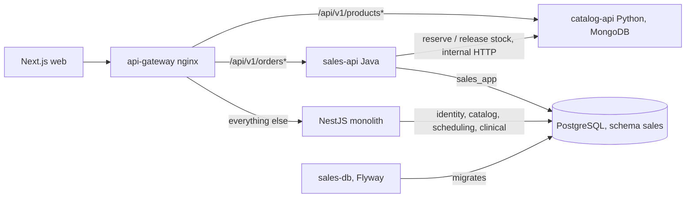

# Spec — Sales: checkout as the first extracted service

**What the Sales service must do, and what must be true when it leaves the monolith.** Sections 1–6
are business: a reader without code should be able to object. Sections 7–8 fix the decisions that
bind the plan (language, data, gateway, cutover). Folder structure and class design are the plan's
job and do not live here.

- **Scope:** one capability — *placing an order* — plus the three routes that share its table
  (`mark-paid`, order list, in-store checkout). Strangler Fig: the NestJS monolith keeps running
  while `sales-api` takes over `/api/v1/orders*`.
- **Origin:** HU-SALES-001, 002 and 003; FR-007, FR-009; course Annex J (2026-B); the professor's
  templates `api-java`, `api-gateway-nginx` and `db-postgres-flyway`.
- **Date:** 2026-10-03
- **Author:** Brandow Stivent Claros Polania (`BrandowC`)
- **Verified against:** the monolith's Sales and Catalog sources and tests (`BrandowC/amaranta`,
  `develop`, working tree — not all committed yet), and the sources of the three templates. The
  Java service does not exist yet: every "Java test" below is a test to write **before** the code.

---

## 1. Problem

A pet shop sells from a website and from a counter against **one** stock. The checkout is where
those two meet. It must sustain four claims, and everything else here is accessory:

1. **A checkout never takes stock for an order that does not exist, and never promises stock that
   is not there.**
2. **An order says what was bought, at what price and whom to contact — and that never changes
   afterwards.** Only its payment state moves.
3. **Buying does not require an account.** Only the clinic features do.
4. **Leaving the monolith is invisible to the person buying.** The only visible differences are
   the contract upgrades listed in §8.2, and the web client adapts to each of them.

---

## 2. Actors

| Actor | Who they are | What they can do here |
|---|---|---|
| **Visitor** | Anyone sending no token | Place an online order |
| **Customer** | A registered `CUSTOMER` with a valid token | The same, list their orders, and the order is attributed to them |
| **Receptionist** | `RECEPTIONIST` | Place an in-store order and mark an order as paid |
| **Catalog** | The monolith's catalog module — a *system*, not a person | Answers stock reservations; it is the only owner of stock |
| **Everyone else** | Veterinarian, groomer, administrator | Nothing in this capability |

The buyer is not an actor with data: an order records whom to contact (name, phone), not a profile.

---

## 3. User stories

### HU-C1 — Place an online order without an account

> As a **visitor**, I want to buy without registering, so I can get what I need today.

- **CA-C1.1** Given stock, an open shop and a valid request, then the order is created `PENDING`,
  channel `ONLINE`, total equal to the sum of its lines, answered `201` with a `Location` header.
- **CA-C1.2** Given **no** `Authorization` header, then the order is created for the walk-in
  customer and appears in no account's history.
- **CA-C1.3** Given a valid customer token, then the order belongs to that customer and appears in
  their list.
- **CA-C1.4** Given a token that is present but invalid or expired, then `401 UNAUTHORIZED`, and
  nothing is reserved. A broken session is never silently turned into a guest purchase.
- **CA-C1.5** Given an `Idempotency-Key` missing, or shorter than 8 or longer than 128 characters,
  then `400 VALIDATION_ERROR`.
- **CA-C1.6** Given a retry with the same `Idempotency-Key`, then `200` and the **same** order; the
  stock was reserved once.
- **CA-C1.7** Given `DELIVERY` without an address, then rejected. Given `PICKUP` with one, then the
  address is dropped, not stored.
- **CA-C1.8** Given the shop is closed — Monday–Saturday 08:00–12:00 and 14:00–18:00, Bogotá time;
  Sunday all day — then `422 BUSINESS_RULE_VIOLATION`, whichever the channel.
- **CA-C1.9** Given an empty list, the same product on two lines, a quantity outside 1–50, or a
  blank contact name or phone (whitespace included), then rejected.

### HU-C2 — Place an order at the counter

> As a **receptionist**, I want to take the order of the person in front of me, so in-store sales
> use the same stock and records as online ones.

- **CA-C2.1** Given a receptionist token, then the order is `IN_STORE` and `createdBy` is my id.
- **CA-C2.2** Given no `customerId`, then it belongs to the walk-in customer; given one, to them.
- **CA-C2.3** Given any other role, then `403 FORBIDDEN`, **before any stock is touched**.
- **CA-C2.4** Every rule of HU-C1 applies unchanged: one rule set for both channels.

### HU-C3 — A rejected order leaves the stock untouched

> As the **shop owner**, I want a failed checkout to cost nothing, so the stock on screen is the
> stock on the shelf.

- **CA-C3.1** Given a quantity above the stock, then the whole order is rejected and nothing is
  discounted.
- **CA-C3.2** Given several lines where a later one lacks stock, then the earlier ones are given
  back.
- **CA-C3.3** Given a rule that needs no Catalog data is broken — closed shop, duplicate line,
  blank contact, quantity out of range, missing address — then Catalog is **never called**. (The
  monolith reserves first and gives back; the service checks first. The client cannot tell.)
- **CA-C3.4** Given saving the order fails after reserving, then the reservation is released.
- **CA-C3.5** Given the order is saved and only publishing its event fails, then the stock **stays**
  discounted: the order exists.
- **CA-C3.6** Given two simultaneous orders for the last unit, then exactly one is created and the
  other is rejected; stock is never negative.
- **CA-C3.7** Given a product that does not exist or is inactive, then the order is rejected.

### HU-C4 — An order is a snapshot

- **CA-C4.1** After an order, renaming, repricing or deleting its product leaves the order showing
  the **name and unit price of the purchase**.
- **CA-C4.2** The total always equals the sum of the line subtotals, because it is computed.
- **CA-C4.3** After creation, no operation edits lines, contact data or total (RN-10).

### HU-C5 — Mark an order as paid

- **CA-C5.1** Given a `PENDING` order and a receptionist, then it becomes `PAID`.
- **CA-C5.2** Given any other status, then `422 INVALID_STATUS_TRANSITION`.
- **CA-C5.3** Given an unknown id, then `404 NOT_FOUND`. Marking as paid never touches lines or stock.

### HU-C6 — List my orders

> The route moves with the table it reads, so it is specified here although it is not checkout.

- **CA-C6.1** Given a customer token, then I see my orders only, newest first, as
  `{data, meta: {page, limit, total, totalPages}}`; `limit` defaults to 20, maximum 100.
- **CA-C6.2** Given a `page` or `limit` out of range, then `400 VALIDATION_ERROR` with one entry per
  field. Given no token, then `401`.

### HU-X1 — The extraction is invisible

> As **a person buying**, I want the cart to keep working through the cutover.

- **CA-X1.1** The public paths are `/api/v1/orders*` through the gateway, before and after.
- **CA-X1.2** One contract suite, run unchanged against the monolith and against `sales-api`,
  passes on both. The differences it tolerates are exactly the rows of §8.2.

### HU-X2 — The cutover can be undone

> As the **operator**, I want to go back by changing one route.

- **CA-X2.1** Pointing the gateway route back at the monolith restores the old behaviour with no
  data change: every order `sales-api` wrote is readable by the monolith.
- **CA-X2.2** At any moment exactly one of the two services receives `/orders*`, so exactly one
  writes the `sales` schema.

### HU-X3 — The web client adapts to the new contract

> As **the web team**, I want the client changes small, listed and testable.

- **CA-X3.1** `api.ts` reads the error code from `error` when `code` is absent, and
  `translateApiError` keeps translating per rule id (OD-2).
- **CA-X3.2** The cart sends one fresh `Idempotency-Key` (a UUID) per purchase attempt, and reuses
  it when the person presses *Confirm* again after a timeout.
- **CA-X3.3** The orders page reads `data` from the paginated answer and asks for `limit=20`.
- **CA-X3.4** `API_URL` points at the gateway; no page calls the monolith's port directly.

---

## 4. Business rules

Numbered so a test or a review can cite them. **A rule nobody tests is an intention, not a rule**,
so each row says who enforces it, which test exists **today in the monolith**, and which Java test
must be written **first**. `None` means none.

Monolith test prefixes: `O` = `order.entity.spec.ts`, `C` = `checkout.use-case.spec.ts`,
`R` = `reserve-stock.concurrency.spec.ts`, `P` = `product.entity.spec.ts`. Java: `OT` =
`OrderTest` (core), `CS` = `CheckoutServiceTest` (app), `API` = `OrderApiTest` (HTTP),
`IT` = `JdbcOrderRepositoryIT` (real PostgreSQL), `CAT` = `CatalogStockHttpAdapterTest`.

| # | Rule | Enforced by (in `sales-api`) | Monolith test today | Java test to write first |
|---|---|---|---|---|
| RN-01 | Total = sum of line subtotals | Core, by construction: computed, never stored as truth | `O·total always equals the sum of item subtotals` | `OT·totalEqualsTheSumOfTheLines` |
| RN-02 | At least one line | Adapter (shape) and core | `O·cannot be created without items` | `OT·rejectsAnOrderWithoutLines` |
| RN-03 | A product once per order | Core only — no unique key in the DDL | `O·rejects duplicate products…` · `C·releases the reservation when the same product appears on two lines` | `OT·rejectsTheSameProductTwice` · `CS·doesNotReserveForADuplicateLine` |
| RN-04 | Line quantity 1–50 | Adapter (shape), core and `CHECK` on `order_items.quantity` | **None** | `OT·rejectsAQuantityOutsideOneToFifty` |
| RN-05 | Contact name and phone present, not blank | Adapter (blank, whitespace included) and core | `O·requires contact name and phone` · `C·releases the reservation when the aggregate rejects the order…` | `OT·rejectsBlankContactData` |
| RN-06 | `DELIVERY` needs an address; `PICKUP` stores none | Adapter and core | three `O·` tests on delivery address | `OT·requiresAnAddressForDelivery` · `OT·dropsTheAddressOnPickup` |
| RN-07 | No order while the shop is closed, in Bogotá time | Core, with an injected clock | `O·cannot be created while the store is closed` · `O·can be created right at opening time` · `C·releases the reservation when the store is closed` | `OT·rejectsOrdersWhileTheShopIsClosed` · `OT·acceptsAnOrderAtOpeningTime` · `CS·doesNotReserveWhenTheShopIsClosed` |
| RN-08 | Stock is reserved and released only through Catalog; Sales never writes `catalog` | Port `ProductStock`; `CatalogStockHttpAdapter` | `P·rejects decrementing below zero` · `R·does not oversell the last unit…` — *the SQL half runs on an in-memory double, not on PostgreSQL* | `CAT·mapsInsufficientStockToABusinessRuleViolation` |
| RN-09 | A rejected order gives its reservation back | Use case (compensation, not a transaction) | five `C·` tests of *a rejected checkout leaves the stock…* · `R·…releases the 1st back` | `CS·releasesTheReservationWhenSavingFails` · `CS·keepsTheReservationWhenOnlyPublishingFails` |
| RN-10 | Lines, contact data and total never change; status only `PENDING → PAID` | Held by absence: no mutator, no route | **None** | `API·offersNoRouteThatEditsAnOrder` · `OT·hasNoMutatorExceptPay` |
| RN-11 | Only `PENDING` can become `PAID` | Core | `O·markAsPaid moves PENDING to PAID` · `O·cannot mark a non-PENDING order as paid twice` | `OT·onlyAPendingOrderCanBePaid` |
| RN-12 | A line keeps the name and unit price of the purchase | Own columns; no foreign key to catalog | **None** | `IT·keepsTheFrozenNameAndPrice` |
| RN-13 | Other domains by id only; Sales writes only schema `sales`, as `sales_app` | DDL and grants (Annex J §J.3–J.4) | **None** | `IT·salesAppCannotWriteOtherSchemas` |
| RN-14 | Guest on `POST /orders`; receptionist on in-store and mark-paid; token on the rest | Adapter filter and gateway route | **None** (no HTTP-level test exists) | `API·acceptsGuestCheckoutWithoutAToken` · `API·rejectsAnInvalidTokenOnCheckout` · `API·onlyAReceptionistCanPlaceInStoreOrders` |
| RN-15 | One order per `Idempotency-Key` | Adapter out; key and order in one transaction | **None** (does not exist) | `CS·replaysTheSameOrderForTheSameKey` · `IT·savesTheOrderAndTheKeyAtomically` |

### 4.1 · What the monolith does not protect today

RN-04, RN-10, RN-12, RN-13, RN-14 have no test, and RN-15 has no implementation. They do not close
the same way: RN-04 needs one unit test; RN-10 is *structural* — it is proved by checking that no
operation violates it; RN-12, RN-13 and RN-15 need a real PostgreSQL, which the Java template's
integration test already provides (`TEST_DATABASE_URL`); RN-14 needs an HTTP-level test, which the
contract suite of §8.5 supplies. The new service is where these rules stop being luck.

---

## 5. Non-functional requirements

| # | Requirement | Acceptance |
|---|---|---|
| RNF-C1 | **Integrity under concurrency** | Two simultaneous orders for the last unit leave non-negative stock (CA-C3.6) |
| RNF-C2 | **Historical fidelity** | An order read a year later says what it said the day it was placed |
| RNF-C3 | **Safe retry** | A retried `POST` never creates a second order (CA-C1.6) |
| RNF-C4 | **Traceability** | Every response and every log line carries `X-Correlation-Id`; every error carries `traceId` |
| RNF-C5 | **Testability** | Core has no Spring dependency: a framework annotation in the domain does not compile |
| RNF-C6 | **Reversibility** | The cutover is one route and is undone by one route (HU-X2) |

---

## 6. Out of scope

- **Payment processing.** The method is recorded as intent; `PAID` is set by a person.
- **Cancelling and fulfilling an order.** The statuses exist; no operation reaches them (FR-010).
- **Events over a broker.** `OrderCreated` is logged by the service; RabbitMQ (ADR-003) and the
  notification service come later, through `worker` and `workflow`.
- **A portal per domain, MongoDB, and the other services.** This cut extracts one service.
- **Delivery fees, taxes, discounts, multi-currency, a server-side cart.**

---

## 7. Decisions

### 7.0 · Closed

| # | Question | Decision | Consequence |
|---|---|---|---|
| **DP-1** | Does buying require an account? | **No** | The template demands a token on every `/api/` route; **`POST /api/v1/orders` is the single exception**, both at the gateway route and in the service filter. A *present but invalid* token is still `401` |
| **DP-2** | Different rules per channel? | **No** — one rule set, one use case | The channel changes only who may call and who the author is |
| **DP-3** | Reserve before or after the order exists? | **Before** — the lines need the name and price only Catalog knows. But everything decidable *without* Catalog (shape, hours, duplicates) is checked **first** | A closed shop never touches the stock. What cannot be predicted — the save failing — is compensated (RN-09): compensation, not atomicity |
| **DP-4** | Which hours and which clock? | Monday–Saturday 08:00–12:00 and 14:00–18:00, **`America/Bogota`**, from an injected clock | Closes the monolith's gap G-3 (server local time) and makes RN-07 testable at any hour |
| **DP-5** | Who marks an order as paid? | The receptionist only (FR-010 also names the administrator; nobody asked) | One role check |
| **DP-6** | Language and shape | **Java**, the `api-java` template: three Maven modules, `core` without Spring | With Catalog in Python, Java and Python satisfy Annex J's two-language rule without counting the monolith ([ADR-012](../05-architecture/decisions/records/ADR-012-stack-of-extracted-services.md)) |
| **DP-7** | Where does the data live? | Same PostgreSQL instance, **schema `sales`**, user `sales_app` (Annex J §J.3–J.4) | **No data moves.** `V004` and `V006` become the baseline of `sales-db`; the first new migration adds `sales.idempotency_key` |
| **DP-8** | How does Sales reach Catalog? | Two **internal** HTTP endpoints, never published through the gateway: served by the monolith first, by `catalog-api` (Python, MongoDB — [ADR-010](../05-architecture/decisions/records/ADR-010-engine-per-domain-sales-postgres-catalog-mongo.md)) once Catalog leaves | `release` is called **at most once**, never retried: a retry would credit twice. A failed release leaves units reserved — the declared residue. Upgrade path: a reservation id |
| **DP-9** | Who validates the token? | The service itself: RS256, public key only (ADR-009) | The monolith's identity module stays the issuer; the role comes from the token |
| **DP-10** | How is the cutover done? | By gateway route, **all four Sales routes together** | One writer of the schema at a time (CA-X2.2). The monolith's Sales module is deleted only after §9 passes |
| **DP-11** | Which template contracts do we adopt? | Error envelope, `Idempotency-Key`, pagination — all three | §8.2 lists each difference |
| **DP-12** | Which gateway? | **nginx**, the professor's template — configuration, not code | Requires an ADR superseding ADR-005 (Kong) |

### 7.1 · Open

| # | Question | Recommendation | Who decides |
|---|---|---|---|
| **OD-1** | Money in whole pesos (today) or minor units (the template's `totalCents`)? | Keep whole pesos and declare the deviation: converting is a data migration for no change anyone sees | Team + professor |
| **OD-2** | Where does the rule id (`INV-ORDER-008`) travel in the envelope? The template branches on `error` (`BUSINESS_RULE_VIOLATION`) and uses `details` for fields | `details: [{field: "rule", message: "INV-ORDER-008"}]`, so the web can keep translating per rule | Sales owner |
| **OD-3** | How do the internal Catalog endpoints trust their caller? | Docker network only for this cut; a shared-secret header when anything is exposed | Team |
| **OD-4** | Table names: today `orders`, `order_items`; the template's rule is singular | Keep this cut; rename later by expand-then-contract | Team + professor |

---

## 8. From monolith to service

### 8.1 · Target for this cut

The seams already exist in the monolith: `ProductStockPort` was written to be replaced by an HTTP
adapter, and `OrderCreatedListener` is the stand-in for the notification service.

### 8.2 · Contract changes, all intentional

| Concern | Monolith today | `sales-api` | Client impact |
|---|---|---|---|
| Error body | Three shapes | `{error, message, details?, traceId}` | `api.ts` reads `error` as well as `code` |
| Business rule broken | `400` | `422 BUSINESS_RULE_VIOLATION` | None — the web branches on the rule id (OD-2) |
| Illegal status change | `400` | `422 INVALID_STATUS_TRANSITION` | None |
| Missing order | `404`, other body | `404 NOT_FOUND` | None |
| Wrong role | `403`, other body | `403 FORBIDDEN` — an addition to the template's code set | None |
| Retries | Duplicate order | `Idempotency-Key` required; `200` on replay | The cart sends one UUID per attempt |
| Order list | Plain array | `{data, meta}`, `limit` ≤ 100 | `orders/page.tsx` reads `data` |
| Path | `/orders` on `:8080` | `/api/v1/orders` through the gateway | `API_URL` points at the gateway |
| Token on checkout | Optional, invalid = guest | Optional, **invalid = 401** | None |

### 8.3 · Status and code per rejection

| Situation | Status | `error` | Rule id in `details` (OD-2) |
|---|---|---|---|
| Empty list, quantity outside 1–50, blank contact, `DELIVERY` without address, malformed id, bad `Idempotency-Key` | `400` | `VALIDATION_ERROR` | — (one entry per field) |
| No token where one is required; an invalid or expired token anywhere | `401` | `UNAUTHORIZED` | — |
| Wrong role | `403` | `FORBIDDEN` | — |
| Unknown order | `404` | `NOT_FOUND` | — |
| Same product on two lines | `422` | `BUSINESS_RULE_VIOLATION` | `INV-ORDER-003` |
| Shop closed | `422` | `BUSINESS_RULE_VIOLATION` | `INV-ORDER-008` |
| Product missing or inactive | `422` | `BUSINESS_RULE_VIOLATION` | `PRODUCT_NOT_FOUND` |
| Insufficient stock | `422` | `BUSINESS_RULE_VIOLATION` | `INV-PRODUCT-002` |
| `mark-paid` on an order that is not `PENDING` | `422` | `INVALID_STATUS_TRANSITION` | `INV-ORDER-005` |
| Catalog unreachable or timed out | `503` | `SERVICE_UNAVAILABLE` — the gateway already uses it | — |
| Anything unexpected | `500` | `INTERNAL_ERROR` | — |

This table closes the monolith's gap G-1: a state conflict or a missing resource is no longer
reported as `400`.

### 8.4 · What moves where

| In the monolith | In `sales-api` |
|---|---|
| `Order`, `OrderItem` and their invariants | `sales-core`, package `domain.model` — no Spring |
| `ShopHours` (server local time) | `sales-core`, using an injected `Clock` in `America/Bogota` |
| `CheckoutUseCase`, `MarkOrderAsPaidUseCase`, `ListMyOrdersUseCase` | `sales-core`, package `application.usecase` |
| `ProductStockPort` | `sales-core`, package `application.port.out`, plus `release` |
| `CatalogStockAdapter` (in-process call) | `CatalogStockHttpAdapter` in `sales-adapters` — the one new piece of real code |
| `OrderRepository` (TypeORM) | `JdbcOrderRepository` in `sales-adapters`, writing key and order in one transaction |
| `SalesController` and the DTOs | `OrderController` and `ErrorHandler` in `sales-adapters` |
| `OptionalJwtAuthGuard`, `RolesGuard` | `AuthFilter`, optional on `POST /api/v1/orders` only, and a role check |
| `WALK_IN_CUSTOMER_ID` | A constant in `sales-core`; the identity row stays in the monolith, referenced by id only |
| `OrderCreatedListener` | A log line in `sales-app`, until the broker arrives |

### 8.5 · Steps, each with its exit

1. **Contract suite on the monolith.** One HTTP file covering every criterion of §3; it is also the
   missing HTTP-level test of RN-14. *Exit:* green against the monolith.
2. **Gateway in front.** The template's `nginx` with an `orders.conf` route pointing at the
   monolith, the web origin added to CORS, the guest exception of DP-1. *Exit:* the web works
   through the gateway; suite still green.
3. **Internal Catalog endpoints.** `POST /internal/products/reserve-stock` takes
   `{items:[{productId, quantity}]}` and answers `{lines:[{productId, productName, unitPriceAmount,
   quantity}]}`; `release-stock` takes the same items and answers `204`. They wrap the use cases
   that exist today, and move to `catalog-api` when Catalog is extracted: `sales-api` then
   changes one URL. *Exit:* tests green; unreachable through the gateway.
4. **`sales-db`.** Flyway baselined on what `V004` and `V006` created, plus the idempotency
   migration; `sales_reader`, `sales_writer`, `sales_app`; `GRANT sales_writer TO sales_app`.
   *Exit:* `flyway validate` green on an empty database and on the existing one.
5. **`sales-api`, tests first.** Core, then use cases, then adapters, each rule of §4 starting from
   its failing Java test. *Exit:* `mvn verify` green, integration tests included.
6. **Same suite, new URL.** *Exit:* the contract suite of step 1 passes against `sales-api`
   with only the differences of §8.2.
7. **Flip the route.** *Exit:* §9 passes; the Sales module is then removed from the monolith.

### 8.6 · Writes cannot be mirrored

Sending a copy of live checkouts to both services would reserve every unit twice. There is no
shadow mode for writes: confidence comes from step 6 and from the checks of §9. Reads (`GET`) may
be compared between the two.

### 8.7 · Risks of the cut

| Risk | Impact | Mitigation |
|---|---|---|
| `release` fails, or `sales-api` dies between reserve and save | Units stay reserved with no order behind them | Declared residue (DP-8); a reservation id with an idempotent release is the upgrade |
| `reserve` times out *after* Catalog reserved | An ambiguous failure: stock gone, no order | The same residue; short timeouts, and the answer is `503`, never a silent retry |
| The guest exception weakens the template's "token everywhere" rule | One public write route | Rate limit stays on; CA-C1.4 keeps a broken token from passing as a guest |
| Sales needs Catalog at run time | Checkout answers `503` while Catalog is down | Declared (§8.3); each service is tested with the other replaced by a double; no shared database |
| The monolith still connects with one administrator user | Annex J §J.10 cannot pass for it | Declared in §9; fixing it is the monolith's migration, not this cut's |

### 8.8 · Repositories and documents

- **New:** `amaranta-shop-sales-api`, `amaranta-shop-sales-db` (assuming `<abbr>` is
  `amaranta-shop`, as in `amaranta-shop-docs`), and the transversal `amaranta-shop-api-gateway`.
  The infrastructure repositories are created by the professor through an issue in `-docs`.
- **Recorded in ADRs:** engines per domain (ADR-010), identity and revocation (ADR-011), stack —
  Java, Python, nginx; supersedes ADR-005 and partially ADR-006 (ADR-012) — and monolith first
  (ADR-013).
- **To correct:** FR-006 and `05-architecture/overview.md` (asynchronous stock saga),
  HU-SALES-001's actor, FR-010, `06-data/models.md` (`orders` lacks the five checkout columns).

---

## 9. Definition of done

**A criterion nobody executed is a wish list.** In order, on a clean machine with Docker; record
what each step returned.

| # | Step | It is good when |
|---|---|---|
| **1** | Contract suite against the monolith, through the gateway | Green (step 1 of §8.5) |
| **2** | `mvn verify` in `sales-api`, with `TEST_DATABASE_URL` set | Green, integration tests included |
| **3** | The same contract suite against `sales-api` | Green, differing only as §8.2 allows |
| **4** | `POST /api/v1/orders` with no token, shop open | `201`, `PENDING`, `ONLINE`; stock fell by exactly the quantity |
| **5** | The same with an expired token | `401 UNAUTHORIZED`; stock identical |
| **6** | Outside shop hours, a duplicate line, a blank contact | `422` or `400` as specified; stock identical each time |
| **7** | Repeat step 4 with the same `Idempotency-Key` | `200`, same order id; stock fell once |
| **8** | Two simultaneous requests for the last unit | One `201`, one `422`; stock `0`, never negative |
| **9** | In-store as a receptionist, then as a customer | `201` with `IN_STORE`; `403 FORBIDDEN` |
| **10** | `mark-paid` twice; once on an unknown id | `200`, then `422 INVALID_STATUS_TRANSITION`; `404` |
| **11** | `GET /api/v1/orders?limit=2` | Own orders only, `{data, meta}` |
| **12** | Stop `sales-api` and call the route | The gateway answers `503` with the envelope |
| **13** | Point the route back at the monolith | Steps 4–10 pass in the old shapes; no data was touched |
| **14** | Annex J §J.10 privilege query, and no foreign key leaving `sales` | `sales_app` writes only in `sales`; zero rows |

**Two things this list cannot check alone:** a manual step is not a guard — steps 5–8 must exist as
tests in the suite and in `mvn verify`; and the Annex J query is only meaningful once the web and the
monolith stop connecting with a single administrator user, which this cut does not change for the
monolith. Declared, not hidden.

---

## 10. Sign-off

**What is accepted.** The four claims (§1), the actors (§2), nine stories with their criteria (§3),
fifteen rules with their tests (§4), six non-functional requirements (§5), the excluded scope (§6),
twelve closed decisions and four open ones (§7), the extraction path (§8) and the definition of
done (§9).

**Against what it was verified.** The monolith's `order.entity.ts`, `checkout.use-case.ts`,
`reserve-stock.use-case.ts`, `sales.controller.ts`, the checkout DTO and the migrations `V003`,
`V004` and `V006`; the `api-java`, `api-gateway-nginx` and `db-postgres-flyway` templates; and Annex
J. The monolith's suite ran green on 2026-10-02 (7 suites, 41 tests).

**Date.** 2026-10-03.

**What stays outside.** The data model (`06-data/`), the API contract (`07-api/`), the class design
of `sales-api`, and OD-1 to OD-4, each still needing its owner. This document says what must be
true, not how much is done.
